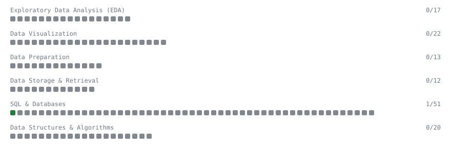

# TrenTorch Solutions

My data science practice from [TrenTorch](https://trentorch.com/questions/part-data-science). Every solution here was written by hand.

**1** solved of 135 · 1 of 6 topics started

[**Browse the interactive portfolio**](https://om-kale-26.github.io/trentorch-solutions/) to replay this filling in over time.

## SQL & Databases

| Problem | Difficulty | Solved | |
|---|---|---|---|
| SELECT All Rows | - | 2026-10-28 | [solution](https://github.com/om-kale-26/trentorch-solutions/tree/main/db-sql-select-all) |

---

*This file is regenerated by a GitHub Action on every push.*
